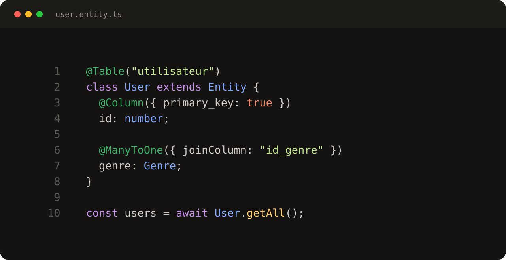
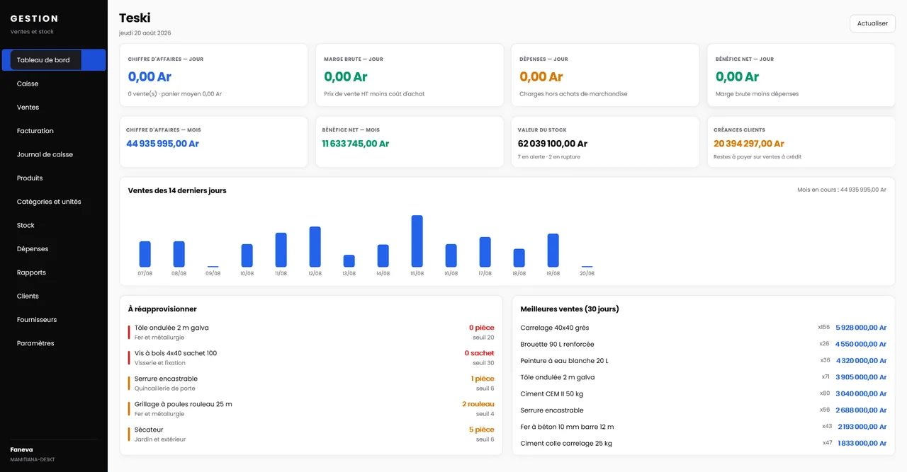
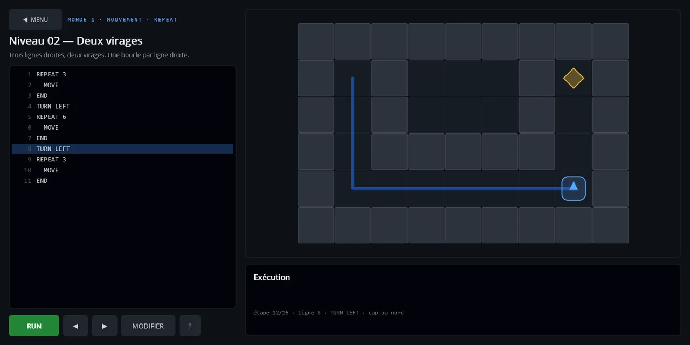
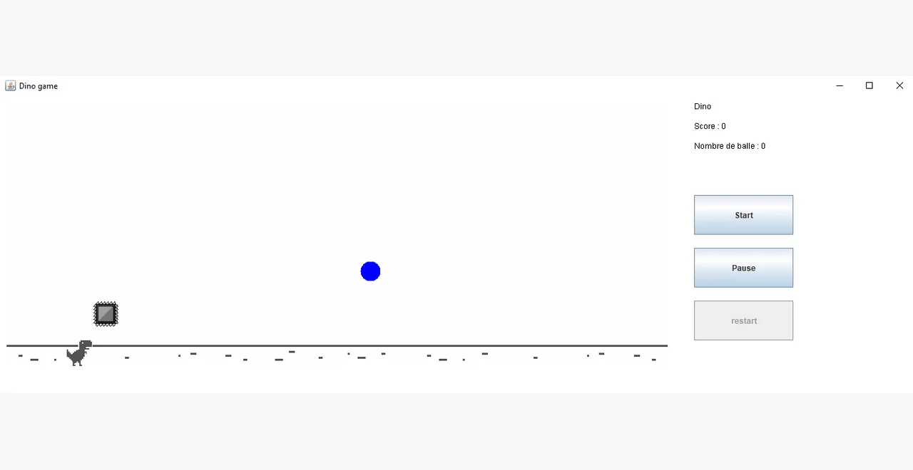

<a href="https://mamitiana-faneva.pages.dev">
  <picture>
    <source media="(prefers-color-scheme: dark)" srcset="readme/banner-dark.svg">
    
  </picture>
</a>

  <a href="https://mamitiana-faneva.pages.dev"><picture><source media="(prefers-color-scheme: dark)" srcset="readme/contact-portfolio-dark.svg"></picture></a>
  <a href="https://www.linkedin.com/in/faneva-mamitiana"><picture><source media="(prefers-color-scheme: dark)" srcset="readme/contact-linkedin-dark.svg"></picture></a>
  <a href="mailto:mamitianafaneva2004@gmail.com"><picture><source media="(prefers-color-scheme: dark)" srcset="readme/contact-email-dark.svg"></picture></a>
  <a href="https://mamitiana-faneva.pages.dev/assets/CV_2026-11-10_Mamitiana%20Faneva_ANDRIAHARIMANANA.pdf"><picture><source media="(prefers-color-scheme: dark)" srcset="readme/contact-cv-dark.svg"></picture></a>

I build backends that hold up in production: **ASP.NET Core APIs at ICP Conseil** since May 2025, and before that Spring Boot, Next.js and Flutter for five companies. I'm now in a **Master 2 BIHAR** (Big Data Intelligence for Human Augmented Reality) at ESTIA, France, and open to freelance missions and full-time roles.

## Now

- **Work** — .NET developer at ICP Conseil, remote · ASP.NET Core, REST APIs
- **Study** — Master 2 BIHAR at ESTIA engineering school, Bidart, France
- **Shipping** — [NodaJPA](https://www.npmjs.com/package/nodajpa), a JPA-style ORM for Node.js, on npm

## Selected work

<table>
  <tr>
    <td width="50%" valign="top">
      
      <h3><a href="https://www.npmjs.com/package/nodajpa">NodaJPA</a></h3>
      A JPA-style ORM for Node.js. Decorators map classes to PostgreSQL tables; an entity manager handles queries, relations and migrations.
        <code>TypeScript</code> <code>PostgreSQL</code> <code>ORM</code> · <a href="https://www.npmjs.com/package/nodajpa">npm</a>
    </td>
    <td width="50%" valign="top">
      
      <h3>Gestion Commerciale</h3>
      A Windows app that runs a hardware store: till, stock, invoices, expenses and reports, on one SQLite file shared between workstations, with 105 automated checks on the money.
        <code>.NET MAUI 9</code> <code>EF Core</code> <code>SQLite</code> · client project, private code
    </td>
  </tr>
  <tr>
    <td width="50%" valign="top">
      
      <h3>Code Quest</h3>
      A Windows game that teaches teenagers to code: a BASIC-like program steers a robot through 200 levels in 21 worlds. A home-made interpreter records every step, so a run can pause, rewind and show its variables.
        <code>C#</code> <code>.NET MAUI 9</code> <code>Interpreter</code> <code>SQLite</code>
    </td>
    <td width="50%" valign="top">
      
      <h3><a href="https://github.com/Mamitiana2004/t_rex_runner">T-Rex Runner</a></h3>
      An endless runner after Chrome's offline dino: a game loop, collisions and a score, all in Java Swing.
        <code>Java</code> <code>Swing</code> · <a href="https://github.com/Mamitiana2004/t_rex_runner">code</a>
    </td>
  </tr>
</table>

<b>More projects</b>

 

| Project | What it is | Stack |
| :-- | :-- | :-- |
| Licence management platform | Software licences managed on a REST backend, with usage shown in real time · *Energetics SARL* | Spring Boot |
| AfTrip | The frontend of a travel booking platform for tourists · *AkeTech Agency* | Next.js, React |
| [Java Resources](https://github.com/Mamitiana2004/StartSpace) | Generic Java code that makes starting a new project faster | Java |
| Clinic management platform | Patient records and appointment scheduling, rendered on the server | Spring Boot, Thymeleaf |
| PDF manager | A React frontend with a Python service behind it, for handling PDF files | React, Python |
| Tetris | A two-player Tetris game | Java |

## Stack

<picture>
  <source media="(prefers-color-scheme: dark)" srcset="readme/stack-dark.svg">
  
</picture>

## Path

<picture>
  <source media="(prefers-color-scheme: dark)" srcset="readme/path-dark.svg">
  
</picture>

  

<a href="mailto:mamitianafaneva2004@gmail.com">
  <picture>
    <source media="(prefers-color-scheme: dark)" srcset="readme/cta-dark.svg">
    
  </picture>
</a>
